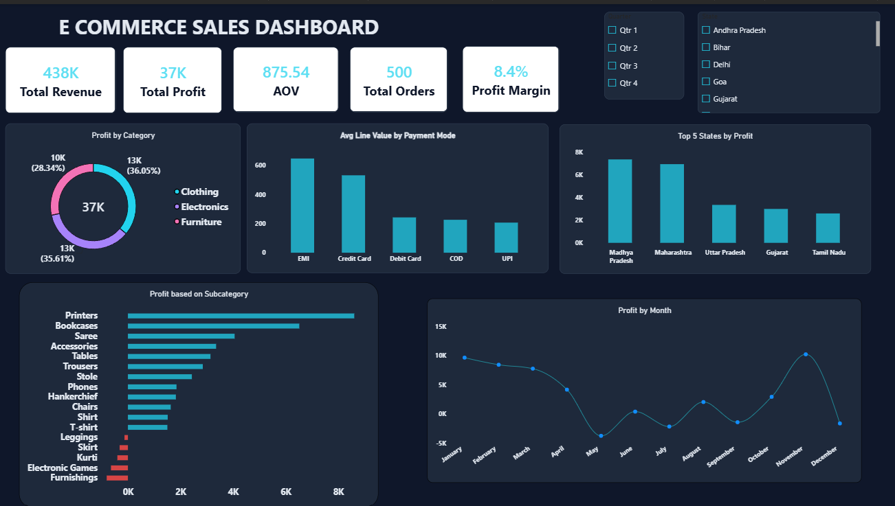
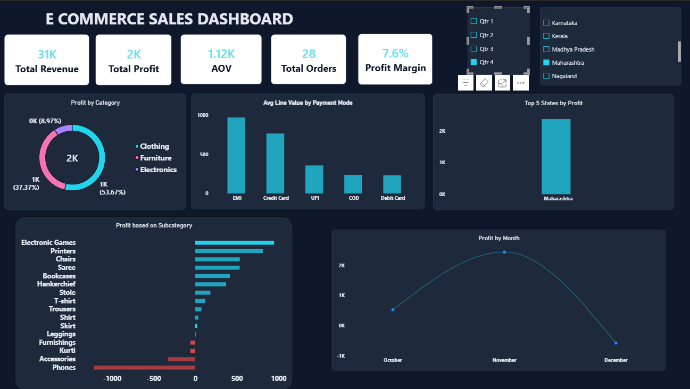

# E-Commerce Sales Dashboard (Power BI)

An interactive Power BI dashboard analysing 2018 e-commerce sales across 19 Indian states. It covers revenue, profit, order value and product performance, with slicers for quarter and state.



## Interactive filtering

Every visual responds to the Quarter and State slicers. The view below shows Q4 for Maharashtra.



## Dataset

Two CSV files, joined on **Order ID**:

| File | Rows | Columns |
|---|---|---|
| `Orders.csv` | 500 | Order ID, Order Date, CustomerName, State, City |
| `Details.csv` | 1,500 | Order ID, Amount, Profit, Quantity, Category, Sub-Category, PaymentMode |

Each order has about three line items. The data covers 1 Jan to 31 Dec 2018, with 3 categories, 17 sub-categories, 5 payment modes, 19 states and 25 cities.

## Data preparation (Power Query)

- Loaded `Orders.csv` and `Details.csv` with **Get Data → Text/CSV**
- Promoted the first row to headers and checked the data types
- Changed `Order Date` to a Date type using the English (India) locale, because the format is dd-mm-yyyy
- Trimmed whitespace in State, City and CustomerName (for example "Kerala " and "Kerala" would otherwise count as two states)
- Checked for nulls, duplicates and orphan Order IDs: there were none
- Set Amount, Profit and Quantity as numeric columns

## Data model

```
Orders (1) ──── Order ID ────► (many) Details
```

- **Orders** is the dimension table: one row per order, with date, customer, state and city
- **Details** is the fact table: one row per line item, with amount, profit, quantity, category and payment mode
- Filters flow from Orders to Details, so the Quarter and State slicers filter every chart

## DAX measures

| Measure | Formula | Why |
|---|---|---|
| Total Revenue | `SUM(Details[Amount])` | Sum of all line-item amounts |
| Total Profit | `SUM(Details[Profit])` | Sum of profit, including losses |
| Total Orders | `DISTINCTCOUNT(Orders[Order ID])` | Counts unique orders, not line items (500, not 1,500) |
| Average Order Value | `DIVIDE([Total Revenue], [Total Orders])` | Revenue per order. DIVIDE avoids divide-by-zero errors |
| Profit Margin % | `DIVIDE([Total Profit], [Total Revenue])` | Profit as a share of revenue |

AOV divides revenue by **distinct orders**, not line items. Averaging the Amount column gives the average line value (about ₹292), which is a different number.

## Dashboard contents

- **KPI cards:** Total Revenue, Total Profit, AOV, Total Orders, Profit Margin
- **Profit by Category:** donut chart
- **Avg Line Value by Payment Mode:** column chart
- **Top 5 States by Profit:** column chart
- **Profit by Sub-Category:** bar chart, with loss-making products in red through conditional formatting rules
- **Profit by Month:** line chart
- **Slicers:** Quarter and State
- **Design:** custom dark theme with a cyan accent colour and red used only for losses

## Key insights

- Total revenue is about ₹4.38 lakh and profit about ₹37K, a **margin of 8.4%** across 500 orders, with an AOV of about ₹876.
- **Madhya Pradesh** and **Maharashtra** are the most profitable states.
- About **35% of line items (529 of 1,500) lose money.**
- Furnishings, Electronic Games, Kurti, Skirt and Leggings are loss-making sub-categories. Printers and Bookcases earn the most.
- **Profit peaks in November** and is negative in May, July, September and December.
- EMI and Credit Card orders have the highest average line value, while COD brings in the most revenue overall.

## What I learned

- Measures and calculated columns behave differently: measures respond to slicers, columns don't
- AOV needs a distinct count of orders. Averaging the Amount column gives the average line value instead
- Conditional formatting rules on a chart need to cover both negative and positive values
- Consistent colours, alignment and font sizes make a big difference to how readable a dashboard is

## Tools

Power BI Desktop, Power Query, DAX

## Files

```
├── Ecommerce_Dashboard.pbix
├── data/
│   ├── Orders.csv
│   └── Details.csv
├── screenshots/
│   ├── pbidashboard_1.png
│   └── pbidashboard_1_filtered.png
└── README.md
```

Open the `.pbix` file in Power BI Desktop to explore the dashboard.
